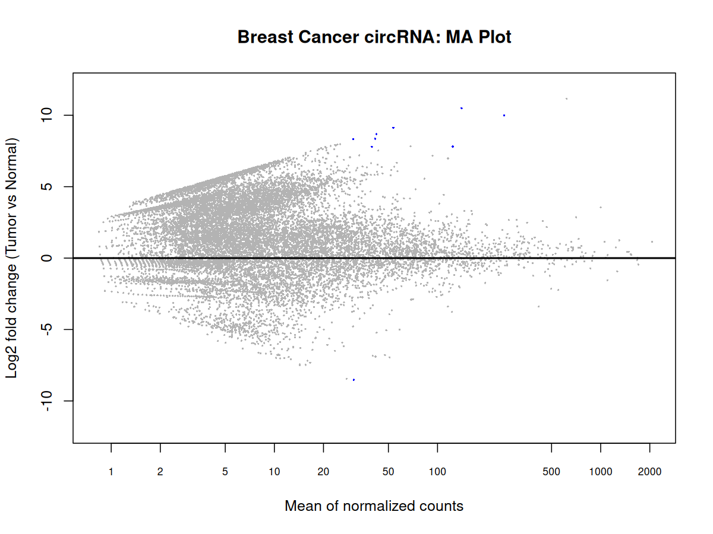
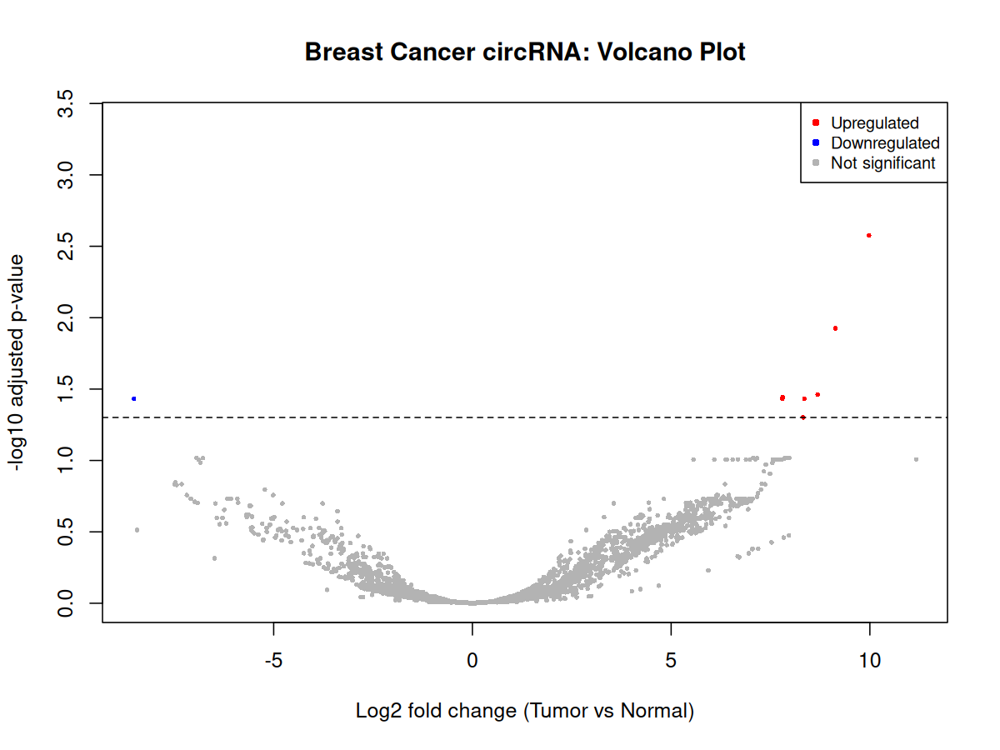
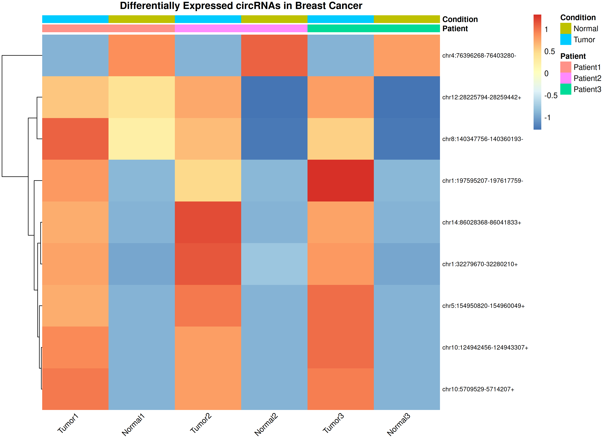

# Breast Cancer circRNA Differential Expression Analysis

## Project Overview

An exploratory bioinformatics reanalysis of publicly
available breast cancer circRNA sequencing data using
R, DESeq2, and genomic annotation.

The project investigates differential circRNA expression
between matched breast tumour and adjacent normal tissues.

## Dataset

- GEO accession: GSE192849
- Samples: 3 paired tumour and adjacent normal tissues
- Total samples: 6
- Original circRNAs: 47,433
- Reference annotation: Ensembl GRCh38

Dataset: https://www.ncbi.nlm.nih.gov/geo/query/acc.cgi?acc=GSE192849

## Analysis Workflow

1. Load and validate circRNA count data.
2. Filter circRNAs with total counts below 10.
3. Perform paired differential expression analysis
   using DESeq2 with design ~ patient + condition.
4. Apply Benjamini-Hochberg multiple-testing correction.
5. Generate MA plot, volcano plot, and expression heatmap.
6. Identify provisional candidate genes using genomic
   containment against saved GRCh38 gene coordinates.

## Key Results

| Metric | Result |
|---|---|
| Original circRNAs | 47,433 |
| Retained after filtering | 23,904 |
| Significant circRNAs (padj < 0.05) | 9 |
| Upregulated circRNAs | 8 |
| Downregulated circRNAs | 1 |
| Candidate containing-gene assignments | 9 |

## Visualizations

### MA Plot

### Volcano Plot

### circRNA Expression Heatmap

## Heatmap Methodology

The nine significant circRNAs were selected from
the saved DESeq2 results.

Raw counts were normalized using previously calculated
DESeq2 size factors recorded to six decimal places.
Values were transformed using log2(normalized counts + 1)
and standardized using row-wise Z-scores.

Rows were hierarchically clustered while sample columns
were maintained in their original paired order.

This transformation is not DESeq2 VST.

## Candidate Gene Annotation

Genomic intervals were compared with saved GRCh38
gene coordinates using chromosome, strand, and
complete genomic containment.

Nine candidate gene assignments were reproduced.
These represent provisional genomic associations,
not experimentally validated circRNA host genes.

The original circRNA genome assembly and coordinate
conventions require independent confirmation.

## Reproducibility

Run the scripts from the project root directory:

1. scripts/01_data_loading.R
2. scripts/02_differential_expression.R
3. scripts/03_heatmap.R
4. scripts/04_volcano_plot.R
5. scripts/05_genomic_annotation.R

Scripts 03–05 use saved project inputs.
The DESeq2 analysis requires the data-loading script
to be run first.

Previously recorded, rounded size factors are saved in
results/DESeq2_size_factors.csv.

## Project Structure

- data/ — Count matrix, metadata, and reference annotation
- scripts/ — R analysis scripts
- results/ — Differential expression and annotation results
- plots/ — MA plot, volcano plot, and heatmap
- report/ — Research report and scientific limitations

## Scientific Limitations

- Only three matched patient pairs were analysed.
- Sparse counts and small sample size may influence
  estimated fold changes and statistical stability.
- Candidate gene assignments are genomic predictions.
- Reference genome and coordinate conventions require
  independent confirmation.
- Findings require independent experimental validation.
- No clinical diagnostic or biomarker validity is claimed.

## Author

Mahi Choudhary
B.Sc. (Hons.) Biotechnology Undergraduate

